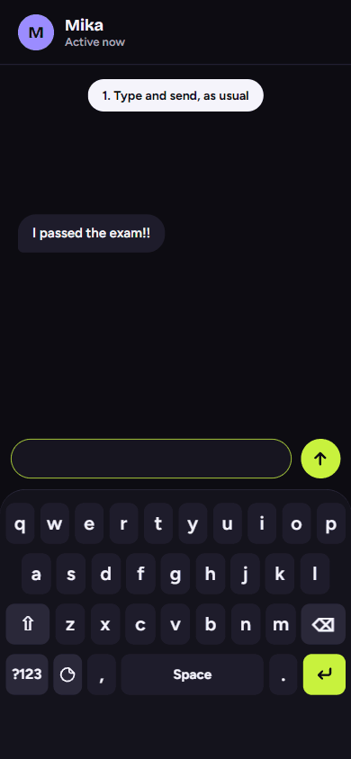
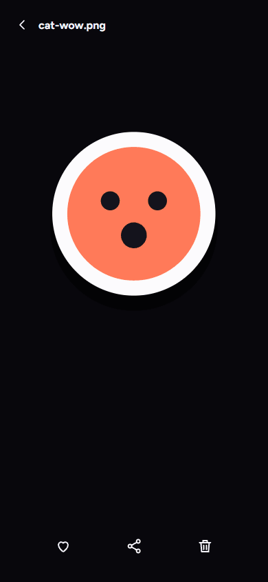
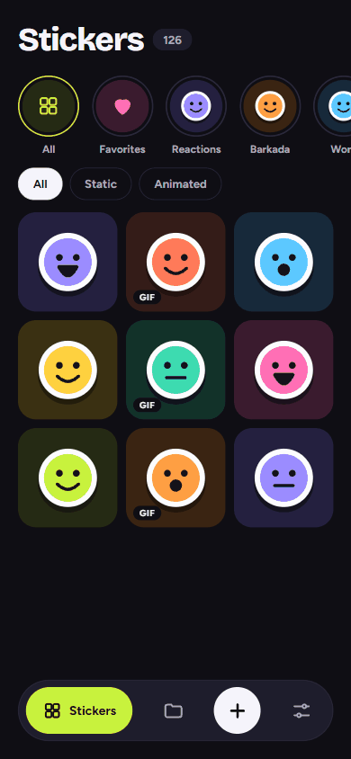

# Kisscut Keys

**Your stickers, one tap away in any chat.**

Kisscut Keys is a sticker manager and keyboard for Android. Save stickers from any app, sort them into collections,
and send them from your keyboard without leaving the conversation. It types like a normal keyboard too.

Everything stays on your phone: no internet permission, no accounts, no ads, no analytics.

> **Coming soon to Google Play.** The store link goes here when the app is published.

## See it in action

<table>
  <tr>
    <td align="center" width="33%"></td>
    <td align="center" width="33%"></td>
    <td align="center" width="33%"></td>
  </tr>
  <tr>
    <td align="center"><b>One keyboard</b><br>Type as usual, then tap the sticker key and send a sticker</td>
    <td align="center"><b>Save from anywhere</b><br>Share any image to Kisscut Keys and pick a collection</td>
    <td align="center"><b>Your library</b><br>Browse by collection, favorites, or just the animated ones</td>
  </tr>
</table>

<sub>Design previews of the real flows. Screens in the app may differ slightly.</sub>

## Features

- **Send stickers in any chat** from the keyboard's sticker panel. If an app doesn't accept images, the sticker is copied so you can paste it
- **Save** stickers from the share sheet or an in-app picker: PNG, JPEG, WebP, GIF and animated WebP
- **Collections**, up to 3 levels deep, plus Favorites, Recents and Unsorted
- **A real keyboard**: QWERTY, numbers and symbols, accents on long-press, a space bar that slides the cursor, and an Emoji tab. Hold Space to switch keyboards
- **Suggestions, autocorrect and swipe typing** in English, worked out on your phone. Autocorrect starts off, so Taglish isn't "fixed"; the row above the keys shows what it would do
- **Make it yours**: key sound, vibration, number row, keyboard height, an optional toolbar, and dark or light theme
- **Back up and share** your stickers as `.stickerpack` files
- **Private by design**: the keyboard never stores, logs or sends what you type; it only holds the word you are typing

## Status

In development. Milestones and progress are in [`docs/ROADMAP.md`](docs/ROADMAP.md).

## Tech

- Kotlin Multiplatform shared logic (`app/shared/`), Room database shared by the app and the keyboard
- Native Android UI in Jetpack Compose (`app/ui/android`)
- Native keyboard built on `InputMethodService`

## Build

Needs a JDK and the Android SDK command-line tools. The Gradle project lives in `app/`. Full setup, emulator and adb notes: [`SETUP.md`](SETUP.md).

```powershell
cd app
.\gradlew.bat test            # fast JVM tests
.\gradlew.bat assembleDebug   # build the debug APK
.\gradlew.bat installDebug    # install on a booted emulator or phone
```

## Docs

| Doc | About |
|---|---|
| [`docs/PRODUCT.md`](docs/PRODUCT.md) | Scope, v1 features, non-goals |
| [`docs/ARCHITECTURE.md`](docs/ARCHITECTURE.md) | Modules, layering, DI |
| [`docs/DATA_MODEL.md`](docs/DATA_MODEL.md) | Room schema and migrations |
| [`docs/UI_SPEC.md`](docs/UI_SPEC.md) | Screens and design tokens |
| [`docs/KEYBOARD.md`](docs/KEYBOARD.md) | The keyboard and sticker insertion |
| [`docs/IMPORT_EXPORT.md`](docs/IMPORT_EXPORT.md) | `.stickerpack` format and security rules |
| [`docs/TESTING.md`](docs/TESTING.md) | Test strategy |
| [`docs/BRAND.md`](docs/BRAND.md) | Name, package ID, icon |
