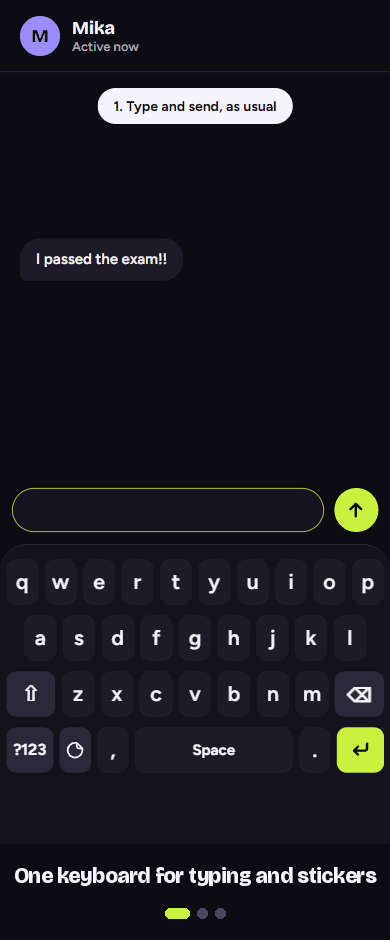

  

<h1 align="center">Kisscut Keys</h1>

<b>Your stickers, one tap away in any chat.</b>

Kisscut Keys is a sticker manager and keyboard for Android. Save stickers from any app, sort them into collections,
and send them from your keyboard without leaving the conversation. It types like a normal keyboard too.

Everything stays on your phone: no internet permission, no accounts, no ads, no analytics.

> **Coming soon to Google Play.** The store link goes here when the app is published.

## See it in action

  

Design previews of the real flows. Screens in the app may differ slightly.

## Features

- **Send stickers in any chat** from the keyboard's sticker panel. If an app doesn't accept images, the sticker is copied so you can paste it
- **Save** stickers from the share sheet or an in-app picker: PNG, JPEG, WebP, GIF and animated WebP
- **Collections**, up to 3 levels deep, plus Favorites, Recents and Unsorted
- **A real keyboard**: QWERTY, numbers and symbols, accents on long-press, a space bar that slides the cursor, and an Emoji tab. Hold Space to switch keyboards
- **Suggestions, autocorrect and swipe typing** in English, worked out on your phone. Autocorrect starts off, so Taglish isn't "fixed"; the row above the keys shows what it would do
- **Learns your words**: names, slang and Taglish you use become known, kept on your phone only and never from password or incognito fields. Turn it off or clear them in Settings
- **Make it yours**: key sound, vibration, number row, keyboard height, an optional toolbar, and dark or light theme
- **Back up and share** your stickers as `.stickerpack` files
- **Private by design**: the keyboard never logs or sends what you type. It holds the word you are typing and the one before it, and the only thing it keeps is the new words it learns, on your phone
